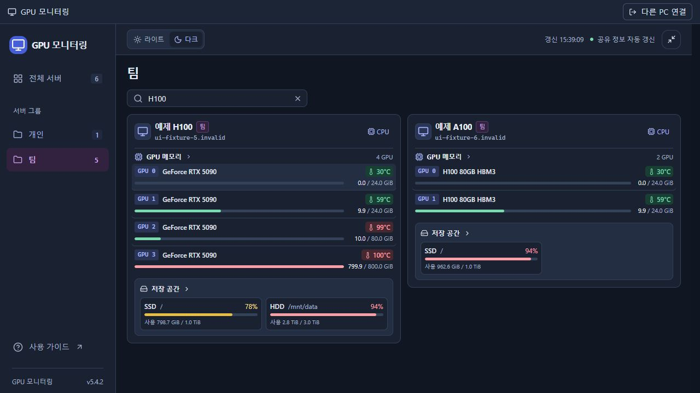

# GPU 모니터링

SSH로 여러 NVIDIA GPU 서버의 상태를 한 화면에서 확인하는 Windows 앱입니다. **v5.4.3**

*별도 공유 서버에 연결한 공유 화면 예시입니다. 화면에는 예제 데이터를 사용했습니다.*

## 주요 기능

- GPU 메모리·온도, CPU·시스템 메모리·저장 공간 조회와 상세보기
- 카드 드래그·크기 조절 및 전체 서버·그룹별 배치 저장
- 작은 창(PiP) 모드로 GPU 상태 확인
- 별도 공유 서버 연결 시 접속 코드로 화면 공유 및 방문자별 탐색 지원
- SSH 서버 지문 확인 및 저장된 인증 정보 암호화

## 실행 방법

Windows 10/11 x64와 [Microsoft Edge WebView2 Runtime](https://developer.microsoft.com/microsoft-edge/webview2/)이 필요합니다.

1. **`GPU 모니터링.exe`**를 내려받아 실행합니다.
2. **서버 추가**에서 SSH 접속 정보를 입력합니다.
3. 서버 지문을 확인하고 연결합니다.

## 화면 공유

**외부 화면 공유를 사용하려면 별도의 공유 서버가 필요합니다.** 앱에는 공유 기능이 있지만, 이를 위한 공유 서버 프로그램과 접속 주소는 제공하지 않습니다. GPU 모니터링과 작은 창 모드는 공유 서버 없이 사용할 수 있습니다.

이 앱과 호환되는 공유 서버가 준비되어 있다면, **처음 한 번 주소를 설정**한 뒤 사용할 수 있습니다.

1. 왼쪽 메뉴에서 **화면 공유**를 엽니다.
2. **공통 공유 주소**에 준비된 공유 서버의 **HTTPS 주소**를 입력하고 **주소 저장**을 누릅니다. 저장한 주소는 다음 실행에도 유지됩니다.
3. 원하는 **접속 코드**를 입력하고 **공유 시작**을 누릅니다.
4. 화면에 표시된 **공유 주소와 코드**를 상대방에게 전달합니다.

상대방은 브라우저에서 코드를 입력해 상태를 조회하고, 그룹 선택·검색·상세보기를 각자 사용할 수 있습니다. 설정은 수정할 수 없으며, 방문자의 탐색은 내 화면에 영향을 주지 않습니다.

공유하는 동안 PC와 앱을 켜 두세요. **공유 중지**를 누르면 접속이 종료됩니다.
